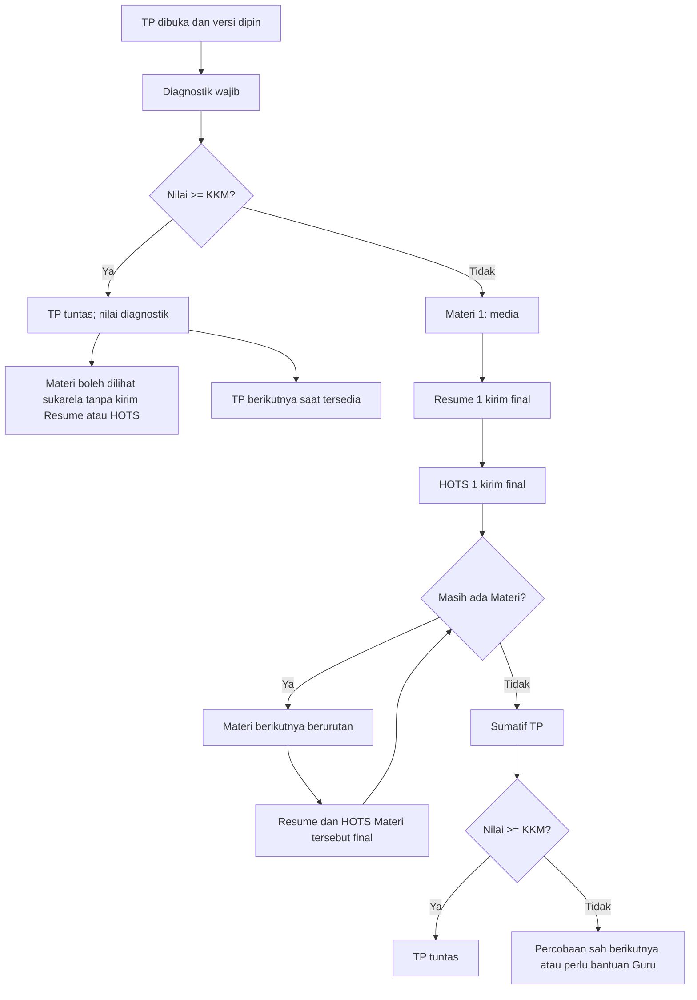

# 06 — Alur Pembelajaran Mandiri Percepatan SKS

## 1. Akses dan urutan
Siswa belajar melalui paket semester **khusus Gen siswa**. Urutan: `Semester → TP → Materi`; tidak ada BAB sebagai langkah atau layar tersendiri. Semester sebelum `COALESCE(siswa.semester_mulai, angkatan.semester_mulai)` berstatus **Dilewati** tanpa nilai/sertifikat. Semester dan TP dibuka berurutan; TP draf berikutnya tidak menghalangi penyelesaian TP Siap sebelumnya, tetapi tampil **"Menunggu TP berikutnya disiapkan Guru"**. Jangan menampilkan semester selesai 100% sebelum **semua TP yang direncanakan** benar-benar disiapkan dan tuntas.

Paket/TP/materi/soal hanya milik Gen yang terkait; siswa Gen A tidak dapat mengakses Gen B dengan URL. Guru penilai adalah G1 aktif Gen–Mapel siswa. Versi TP dipin ketika siswa pertama kali memulai; perubahan Guru/versi konten tidak menghapus progres.

## 2. Mesin alur TP

Alur ini merupakan **kebijakan akademik internal madrasah untuk SKS percepatan dua tahun**. Diagnostik wajib; jika lulus, siswa tidak wajib menuntaskan media/Resume/HOTS dan nilainya dari Diagnostik. Jika tidak lulus, **setiap Materi memiliki Resume dan HOTS sendiri** dan setelah semua Materi final siswa mengikuti Sumatif. Guru tidak boleh memaksakan siswa jalur lulus Diagnostik mengirim tugas resmi; belajar sukarela tidak mempengaruhi nilai.

## 3. Syarat materi dan media
- PDF melalui PDF.js lokal: seluruh halaman pernah dilihat, waktu aktif default 15 detik/halaman. **Untuk video YouTube/audio, batas efektif adalah yang tercapai lebih cepat: waktu minimum Guru ATAU 90% durasi media**, dihitung dari pemutaran sah oleh server; jeda dan seek tidak dihitung. Gambar default terlihat ≥30 detik. Guru dapat mengatur `min_waktu_detik` saat TP masih draf.
- Heartbeat server kira-kira tiap **10 detik**; satu detak menambah maksimum 20 detik dan interval minimal 5 detik. Tab/background/jeda/refresh tidak boleh dihitung sebagai waktu belajar aktif palsu. Validasi jam server; jangan mempercayai durasi dari klien.
- Satu Materi berikutnya dibuka setelah media wajib selesai serta **Resume dan HOTS Materi sebelumnya terkirim final**; tidak perlu menunggu skor Guru. Simpan draf tidak dianggap final. Jika ada lebih dari satu jenis media, syarat materi memeriksa seluruh yang diwajibkan.
- Progres TP berdasarkan langkah jalur aktif; TP lulus Diagnostik langsung 100%. Semester tidak 100% hingga semua TP terencana Siap dan tuntas.

## 4. Resume dan HOTS setiap Materi
Masing-masing mempunyai editor teks, tombol **Simpan draf** manual ke database, status perubahan belum disimpan/berhasil/gagal, serta **Kirim final** yang mengunci hasil dan membuat antrean penilaian. Tidak ada autosave wajib. Pengiriman ganda harus idempoten; browser meminta konfirmasi jika keluar dengan perubahan belum disimpan. Browser boleh mencegah paste biasa, tanpa mengklaim tidak mungkin curang.

Guru memberi nilai 0–100 dan komentar menurut dokumen 08. Siswa boleh melanjutkan setelah kirim final tanpa menunggu Guru, tetapi rapor/sertifikat final menunggu semua skor wajib dinilai. Koreksi skor mengikuti jalur resmi dan audit.

## 5. Pencapaian dan teks status
Lencana per siswa/paket satu kali: `langkah_pertama`, `lolos_diagnostik`, `tp_tuntas`, `setengah_jalan`, `sekali_lulus`, `semester_tuntas`. Lencana lama `bab_tuntas` jika sudah ada di data historis dipetakan saat penataan dump tanpa menghilangkan catatan pemberian lama. Perayaan ringan boleh sesudah TP/semester tuntas, **tidak pernah saat ujian**, dan tidak memberi nilai/poin/ranking.

| Kondisi | Teks siswa |
|---|---|
| TP belum Siap | Menunggu TP disiapkan Guru |
| TP berikutnya terkunci | Selesaikan TP sebelumnya |
| Diagnostik belum dikerjakan | Mulai Diagnostik |
| Lolos Diagnostik | TP tuntas — lanjut atau pelajari materi sukarela |
| Jalur Materi | Baca/tonton, Simpan draf, Kirim final Resume, Kirim final HOTS |
| Penilaian belum lengkap | Menunggu penilaian Guru: n item |
| Ujian dibatalkan | Menunggu keputusan Guru; tidak ada nilai |
| Semester tuntas | Lihat nilai dan sertifikat jika syarat terbit lengkap |

## 6. Halaman Siswa
S01 Beranda, S02 Semester (**daftar TP**), S03 **Detail TP dan daftar Materi** (menggantikan layar BAB), S04 langkah TP/diagnostik, S05 petunjuk ujian, S06 ujian, S07 hasil, S08 materi, S09 Resume per Materi, S10 HOTS per Materi, S11 lencana, S12 nilai, S13 sertifikat. Pengumuman/notifikasi/FAQ/profil merupakan halaman umum. Semuanya ramah HP kecuali Sumatif yang memerlukan desktop/laptop fullscreen sebagaimana dokumen 07.

### Tahap implementasi S09/S10 (25 Oktober 2026)

Formulir Resume dan HOTS per Materi sudah ditautkan ke POST server dengan
Simpan Draf manual, Kirim Final permanen, revisi untuk mendeteksi konflik
antar-tab, dan audit final. Akses Materi berikutnya harus memenuhi ketiga
bukti dari versi konten TP yang terpin: media_selesai, Resume final,
dan HOTS final untuk seluruh Materi sebelumnya. Siswa yang tuntas melalui
Diagnostik tetap dapat membaca sukarela tanpa mengirim jawaban resmi.
Resume dan HOTS minimal sesuai `tp.resume_min`/`tp.tugas_min` pada snapshot TP siswa (bawaan 50/200 karakter); maksimal teknis 12.000 karakter.
PDF belum dapat menuntaskan media tanpa PDF.js lokal. Skor Guru dan Sumatif
belum diterbitkan pada tahap ini.

### S08D — Pembaca PDF.js lokal dan progres per halaman (25 Oktober 2026)

Pembaca PDF siswa hanya memakai library dan worker PDF.js 3.2.146 lokal
(public/assets/vendor/pdfjs/3.2.146), lisensi Apache-2.0. Tidak memakai CDN
atau iframe browser untuk mencatat pembelajaran resmi. PDF yang diperbolehkan
tetap sesuai validator dan keputusan PDF Materi yang sudah FIX (maks. 15 MB,
40 halaman, tanpa pembatasan tambahan pada revisi normal file).

Semua halaman dirender satu per satu dengan Prev/Next, zoom 50–200%,
fullscreen dan navigasi keyboard. Metadata jumlah halaman diperiksa terhadap
berkas privat dalam snapshot TP; data klien tidak boleh mengurangi jumlahnya.
Heartbeat aktif tiap ~10 detik; interval pertama/berganti halaman, saat
perenderan, tab berpindah/kehilangan fokus, koneksi hilang, dan jarak detak
di luar 5–20 detik tidak dihitung otomatis. Setiap halaman memerlukan
sekurang-kurangnya 15 detik kredensial waktu server; seluruh halaman lengkap
dan min_waktu_detik Guru harus terpenuhi sebelum media_selesai.

Progress ditulis ke progres_materi dan halaman_progres_materi dari SQL 0016
melalui transaksi InnoDB, snapshot dan akses siswa divalidasi server. Resume
dan HOTS tetap harus final. Belajar PDF sukarela setelah lulus Diagnostik
tetap tanpa pencatatan/penilaian resmi. Sinyal browser adalah mitigasi
best-effort (tidak dapat membuktikan mata benar-benar membaca).

### Koreksi S09/S10 — minimum teks mengikuti snapshot TP siswa

Nilai `resume_min` (rentang Master 10–1000) dan `tugas_min` (50–5000) dibaca dari `snapshot_json.tp` pada `versi_konten_tp` yang **terpin** di progres siswa. UI serta validasi POST server memakai nilai yang sama, bukan TP live atau angka bawaan hardcode. Nilai snapshot di luar rentang Master / tidak tersedia ditolak dengan galat konfigurasi; tidak melakukan fallback diam-diam, mengubah TP Siap, atau menulis data. Draf tetap boleh singkat. Siswa jalur Diagnostik tuntas tetap tidak dapat mengirim kegiatan resmi. Tidak ada SQL baru.

### Koreksi status Youtube/audio yang terlihat penuh tetapi belum tuntas (25-10-2026)

**Riwayat:** versi 25-10-2026 pernah menampilkan kedua syarat secara bersamaan (AND), sehingga angka 380/360 masih dianggap belum cukup untuk video panjang. **Aturan AND telah diganti** oleh keputusan terbaru 26-10-2026; gunakan ketentuan di bawah, bukan logika lama.

### Keputusan final 26-10-2026 — syarat YouTube/audio yang lebih cepat

Waktu media resmi berakhir ketika **syarat yang lebih pendek terpenuhi terlebih dahulu**: `min(min_waktu_detik Guru, ceil(0.9 * durasi_media_detik))`. Sebagai contoh, minimum Guru 600 detik pada video 420 detik akan selesai setelah **378 detik** pemutaran sah; minimum Guru 600 detik pada video 900 detik akan selesai setelah **600 detik**. Kasus minimum Guru 360 detik dan video sepanjang 9.968 detik diselesaikan setelah **360 detik pemutaran sah**, bukan 8.972 detik.

Waktu pemutaran dihitung melalui heartbeat 5–20 detik dari jam server, menggunakan perubahan posisi yang masuk akal; seek maju/mundur, jeda, playback bukan 1x, tab/background dan interval detak terlalu panjang tidak menambah kredit. Posisi terjauh hanya informasi diagnostik, **bukan syarat tambahan yang membatalkan batas efektif**. Tampilan menunjukkan durasi media, kedua pembanding, target yang berlaku, dan pemutaran sah. Setelah media_selesai, Resume dibuka oleh server, kemudian HOTS setelah Resume final.

**Rekonsiliasi data lama:** bagi siswa yang sudah memiliki `waktu_putar_detik` dan `waktu_aktif_detik` sah setidaknya batas efektif tetapi statusnya `berjalan`, GET status siswa merekonsiliasi status menjadi `media_selesai` secara idempoten untuk progres milik siswa/versi terpin tersebut. Tidak melakukan tambah waktu palsu, menyunting snapshot, impor ulang SQL atau menghapus progres. PDF, gambar dan siswa jalur Diagnostik tuntas tidak berubah.
