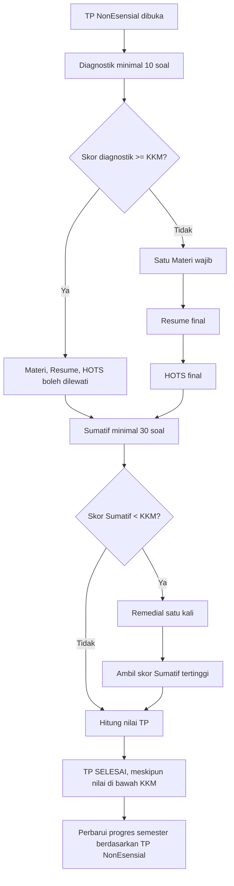

# 06 — Alur Pembelajaran Mandiri Siswa

> **Master v2.5 · Keputusan 26 Oktober 2026.** Mengganti langsung kontrak v2.4 ketika Diagnostik lulus membuat TP tuntas tanpa Sumatif dan beberapa Materi dalam satu TP.

## 1. Peta dan akses
Siswa membuka **Semester → BAB → TP** sesuai Gen–Mapel dan urutan ATP. Paket dan soal milik Gen siswa; versi konten TP dipin ketika mulai. Semester sebelum semester mulai siswa berstatus Dilewati tanpa nilai/sertifikat. TP Esensial ditampilkan informatif tetapi tidak dikerjakan di LMS, tidak dihitung progres.

## 2. Alur wajib TP NonEsensial

- Diagnostik adalah **gate sebelum kewajiban mempelajari satu Materi**, bukan bagian nilai TP. Diagnostik lulus hanya membebaskan Materi/Resume/HOTS; Sumatif tetap **wajib**.
- Siswa jalur belajar menuntaskan Materi, mengirim Resume final dan HOTS final, lalu mengikuti Sumatif. Penyelesaian tidak harus menunggu Guru memberi skor, tetapi nilai TP final menunggu nilai Resume/HOTS.
- Bila Sumatif di bawah KKM, sediakan **hanya satu remedial**; nilai Sumatif yang digunakan adalah nilai tertinggi tes awal/remedial. Setelah kesempatan normal/remedial yang sah diselesaikan, TP berstatus **SELESAI walaupun skor akhir di bawah KKM**. Syarat selesai bukan sama dengan lulus KKM.
- Diagnostik dibatalkan mengikuti keputusan Guru: ulang atau langsung jalur belajar tanpa skor diagnostik sah. Ujian Sumatif yang dibatalkan tidak menghabiskan kesempatan sah dan perlu keputusan Guru.

## 3. Media dan checkpoint
- Hanya satu Materi aktif per TP NonEsensial. Media dapat berupa YouTube, audio, gambar atau PDF; aturan PDF maksimal 15MB/40 halaman dan pembaca PDF.js lokal dipertahankan.
- **Model B yang disepakati:** perhitungan aktivitas media pada sisi klien, dengan **checkpoint otorisasi server setiap 4 menit** atau saat tahap penting/selesai. Jika koneksi terganggu, status lokal sementara mempertahankan akumulasi yang belum terkirim pada perangkat/browser sama dan disinkronkan aman ketika pulih; waktu sudah diakui server tidak diulang dari nol. Server memverifikasi kewajaran waktu, sesi, identitas siswa, media, dan snapshot; data klien saja tidak boleh membuka gate tanpa pengakuan server.
- YouTube/audio memakai batas efektif minimum waktu Guru atau 90% durasi putar nyata (yang lebih dulu tercapai). Seek/jeda/latar tidak dihitung sebagai pemutaran aktif. Gambar/PDF memerlukan aktivitas nyata dan, untuk PDF, semua halaman wajib pernah dibuka menurut syarat halaman yang diatur; komponen client-side tidak mempercayai sekadar tab terbuka.
- Setelah media selesai terverifikasi server: tombol Resume/HOTS dapat dipakai sesuai urutan, serta **Unduh Materi** untuk audio/gambar/PDF terbuka. YouTube tidak menyediakan unduh internal. Tombol Materi Selanjutnya mengikuti unit TP berikutnya jika Resume/HOTS sudah final; fullscreen dan zoom media yang telah diuji tetap dipertahankan.

## 4. Progres semester
`progres = TP_NonEsensial_SELESAI / seluruh_TP_NonEsensial_di_ATP_semester × 100%`. TP Esensial **tidak masuk penyebut atau pembilang**. Jangan tampilkan 100% bila struktur semester belum dinyatakan siap/terkunci atau masih ada TP NonEsensial wajib yang belum selesai; tidak boleh menganggap draf yang belum diterbitkan tidak termasuk rencana.
- Jika semua TP NonEsensial telah selesai, siswa **menunggu jadwal Pra-Semester**. Ujian Pra-Semester tidak dikerjakan kapan saja: Admin menetapkan tanggal dan waktu serentak bagi seluruh siswa di paket semester yang sama. Hanya siswa dengan seluruh TP NonEsensial selesai dapat memulai.
- Hasil Pra-Semester adalah nilai tersendiri dan **tidak membentuk nilai akhir semester**. Aturan kelayakan sertifikat terkait waktu ujian Pra-Semester belum diputuskan; jangan membuat gate tambahan otomatis.

## 5. Status dan UI
Tampilan siswa: Semester (progres), BAB (nama singkat/deskripsi), TP (kode/nama singkat/deskripsi asli/jenis), Diagnostik, satu Materi, Resume, HOTS, Sumatif, Remedial, Pra-Semester terjadwal, nilai, sertifikat. Normal/kosong/loading/error/locked. Jika Sumatif di bawah KKM setelah remedial, tampil **TP Selesai — nilai belum mencapai KKM** tanpa mengunci siswa. Penilaian Resume/HOTS yang belum diberikan Guru tampil Sementara dan tidak disulap menjadi nol.

Pencapaian/lencana boleh dirujuk, tidak menambah poin/ranking. Pengendalian fullscreen ujian dan gangguan koneksi mengikuti dokumen 07; checkpoint media bukan heartbeat keamanan ujian.
