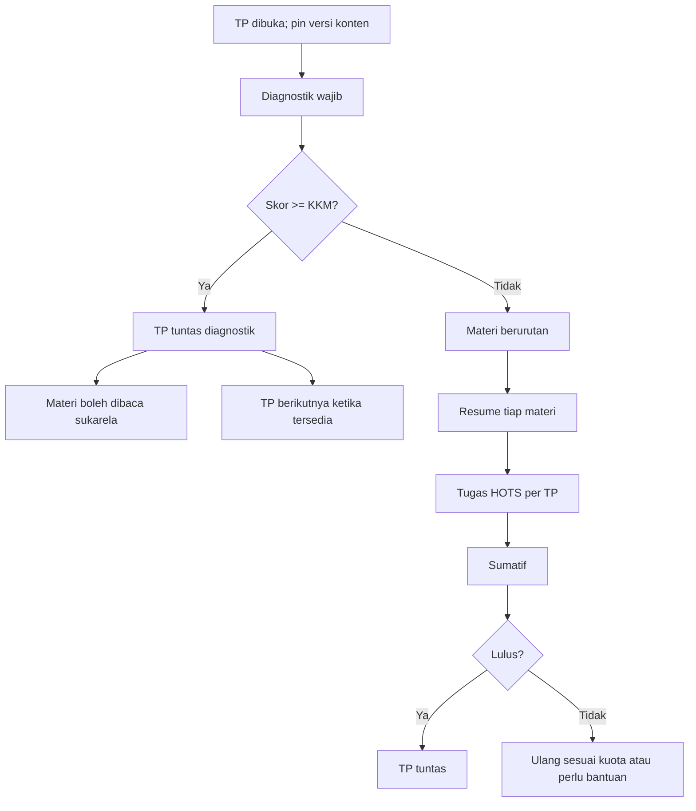

# 06 — Alur Pembelajaran Siswa dan Pencapaian

## 1. Prasyarat akses
Siswa hanya dapat membuka paket yang ditugaskan menurut Gen/tahun ajaran/semester mulai efektif. Semester sebelum titik mulai bertanda **Dilewati** tanpa skor/sertifikat. Semester berikutnya dibuka berurutan setelah sebelumnya memenuhi ketuntasan; BAB dan TP juga berurutan. Jika BAB berikutnya draf, siswa melihat **"Menunggu BAB berikutnya disiapkan guru"**, bukan error kosong.

## 2. Mesin alur setiap TP

Pilihan siswa setelah lulus diagnostik: **lanjut ke TP berikutnya** atau membaca/menonton materi sukarela; siswa **tidak mengirim resume/tugas resmi** pada jalur sukarela, dan nilai TP tetap nilai diagnostik.

## 3. Pembuktian akses materi
- Bacaan PDF: pembaca PDF.js lokal dengan hitung halaman terlihat dan waktu aktif; default 15 detik/halaman, penyelesaian mensyaratkan kunjungan seluruh halaman sesuai aturan lama. Pratinjau akses tidak menulis progres.
- YouTube: IFrame API bila tersedia dan durasi video/putar minimum; default persentase putar minimum 90%, bukan sekadar membiarkan tab terbuka.
- Audio: hitung durasi putar nyata dengan heartbeat; gambar: waktu terlihat pada tab aktif; default waktu gambar 30 detik.
- Pengukuran server menangani jeda tab/background, loncatan, refresh dan gangguan jaringan secara wajar. Semua detak divalidasi, tidak mempercayai durasi mentah yang dikirim klien.

## 4. Perhitungan ketuntasan media yang konsisten
- Server menerima detak media kira-kira **tiap 10 detik**. Untuk mencegah manipulasi durasi, satu detak menambah maksimum **20 detik** dan interval antardetak sedikitnya **5 detik**. Ini parameter implementasi dan tidak menggantikan syarat waktu materi.
- PDF `bacaan`: syarat **semua halaman pernah terlihat** (bitmask terisi) dan `detik_aktif` ≥ jumlah halaman × 15 detik bawaan; Guru dapat mengatur `min_waktu_detik` yang sah untuk materi yang belum Siap.
- Video YouTube/audio: default **≥90% durasi putar**; waktu hanya saat diputar, bukan tab dibiarkan terbuka. Gambar: **≥30 detik** terlihat pada tab aktif. Semua jenis dapat memakai `min_waktu_detik` Guru sesuai pengaturan materi.
- **Satu materi berikutnya** baru boleh dibuka setelah resume materi sebelumnya **terkirim secara final**, bukan baru disimpan sebagai draf. `syarat_terpenuhi_pada` diisi sekali; progres yang sudah benar tidak dihapus karena refresh atau perubahan berkas di masa depan.
- Rumus progres TP = langkah selesai / jumlah langkah jalur aktif; TP lulus diagnostik langsung 100%. Progres BAB = TP tuntas / seluruh TP BAB. Progres semester **tidak boleh 100%** sebelum seluruh BAB yang direncanakan benar-benar dibuat, Siap dan selesai, walau TP dari BAB yang sudah tersedia semuanya tuntas.

## 5. Resume/tugas dan penilaian
Resume tersedia per materi dan tugas HOTS per TP. Teks disimpan **hanya jika siswa memilih `Simpan draf`**, dan disimpan di database (tidak tergantung localStorage). UI menampilkan `Perubahan belum disimpan`, `Draf tersimpan`, atau kesalahan simpan. Setelah `Kirim final`, jawaban dikunci dan antrean penilaian Guru terbentuk. Form tidak boleh mengirim akibat klik ganda; server menggunakan kunci idempoten/syarat status. Batas karakter mengikuti konfigurasi TP. Browser mencegah paste biasa pada editor jawaban, tetapi tidak mengklaim sebagai jaminan pencegahan kecurangan sempurna.

Penilaian resume/tugas oleh Guru **tidak menghambat siswa mengerjakan langkah belajar berikutnya**. Namun nilai akhir/sertifikat belum resmi sampai semua komponen wajib dinilai. Koreksi penilaian menggunakan `08-PENILAIAN.md`.

## 6. Pencapaian
Lencana diraih otomatis per siswa/paket semester, satu kali tiap kode: `langkah_pertama`, `lolos_diagnostik`, `bab_tuntas`, `setengah_jalan`, `sekali_lulus`, `semester_tuntas`. Lencana tidak menambah nilai. Perayaan singkat dapat muncul satu kali setelah TP/BAB/semester tuntas; **tidak pernah di ruang ujian**. Tidak ada peringkat/streak/poin.

## 7. Status dan teks siswa
| Kondisi | Pesan/tindakan utama |
|---|---|
| Semester sebelum mulai | `Dilewati` dan sebab akses |
| BAB draf | `Belum siap`; tidak menampilkan konten tertutup |
| TP terikat tetapi belum boleh dibuka | `Terkunci — selesaikan TP sebelumnya` |
| Diagnostik belum dimulai | `Mulai diagnostik` |
| Lolos diagnostik | `TP tuntas — lanjut atau pelajari materi sukarela` |
| Jalur belajar menunggu resume/tugas | `Baca materi`, `Simpan draf`, `Kirim final` |
| Menunggu penilaian guru | `Menunggu penilaian guru: n item` |
| Ujian dibatalkan | `Menunggu keputusan guru`; tidak tampil nilai palsu |
| Seluruh paket tuntas | `Selesai`; lihat nilai dan sertifikat bila tersedia |

## 8. Tampilan siswa
S01 Beranda (peta semester/lencana/lanjutkan), S02 Semester (BAB), S03 BAB (TP), S04 TP (langkah), S05 petunjuk ujian, S06 ujian, S07 hasil, S08 materi, S09 resume, S10 HOTS, S11 lencana, S12 nilai, S13 sertifikat. Pengumuman, notifikasi, FAQ dan profil merupakan halaman umum. Navigasi harus dapat digunakan keyboard dan layar HP; sumatif sendiri dibatasi desktop/laptop.
