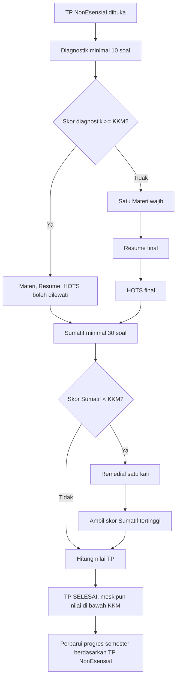

# 06 — Alur Pembelajaran Mandiri Siswa

> **Master v2.5 · Keputusan 26 Oktober 2026.** Mengganti langsung kontrak v2.4 ketika Diagnostik lulus membuat TP tuntas tanpa Sumatif dan beberapa Materi dalam satu TP.

## 1. Peta dan akses
Siswa membuka **Semester → BAB → TP** sesuai Gen–Mapel dan urutan ATP. Paket dan soal milik Gen siswa; versi konten TP dipin ketika mulai. Semester sebelum semester mulai siswa berstatus Dilewati tanpa nilai/sertifikat. **Guru tetap menyiapkan satu Materi untuk semua jenis TP**; kebijakan siswa saat ini menampilkan TP Esensial secara informatif tetapi tidak mewajibkan aktivitas/penilaian LMS dan tidak menghitungnya dalam progres. Konten Guru tetap tersimpan, bukan dihapus.

## 2. Alur wajib TP NonEsensial

- Diagnostik adalah **gate sebelum kewajiban mempelajari satu Materi**, bukan bagian nilai TP. Diagnostik lulus hanya membebaskan Materi/Resume/HOTS; Sumatif tetap **wajib**.
- Siswa jalur belajar menuntaskan Materi, mengirim Resume final dan HOTS final, lalu mengikuti Sumatif. Penyelesaian tidak harus menunggu Guru memberi skor, tetapi nilai TP final menunggu nilai Resume/HOTS.
- Bila Sumatif di bawah KKM, sediakan **hanya satu remedial**; nilai Sumatif yang digunakan adalah nilai tertinggi tes awal/remedial. Setelah kesempatan normal/remedial yang sah diselesaikan, TP berstatus **SELESAI walaupun skor akhir di bawah KKM**. Syarat selesai bukan sama dengan lulus KKM.
- **Diagnostik/Sumatif tidak selesai:** siswa meminta **izin akses ulang Guru** untuk mengulang tahap yang terhenti. **Bukan pembatalan.** Sumatif awal yang belum selesai bukan remedial; remedial yang belum selesai tidak menciptakan kesempatan remedial kedua. Skor sah dan pembatasan satu remedial tetap utuh. Pembatalan hanya berlaku pada Pra-Semester (Master 07).

## 3. Media dan checkpoint
- Hanya satu Materi aktif per TP NonEsensial. Media dapat berupa YouTube, audio, gambar atau PDF; aturan PDF maksimal 15MB/40 halaman dan pembaca PDF.js lokal dipertahankan.
- **Model B yang disepakati:** perhitungan aktivitas media pada sisi klien, dengan **checkpoint otorisasi server setiap 4 menit** atau saat tahap penting/selesai. Jika koneksi terganggu, status lokal sementara mempertahankan akumulasi yang belum terkirim pada perangkat/browser sama dan disinkronkan aman ketika pulih; waktu sudah diakui server tidak diulang dari nol. Server memverifikasi kewajaran waktu, sesi, identitas siswa, media, dan snapshot; data klien saja tidak boleh membuka gate tanpa pengakuan server.
- YouTube/audio memakai batas efektif minimum waktu Guru atau 90% durasi putar nyata (yang lebih dulu tercapai). Seek/jeda/latar tidak dihitung sebagai pemutaran aktif. Gambar/PDF memerlukan aktivitas nyata dan, untuk PDF, semua halaman wajib pernah dibuka menurut syarat halaman yang diatur; komponen client-side tidak mempercayai sekadar tab terbuka.
- Setelah media selesai terverifikasi server: tombol Resume/HOTS dapat dipakai sesuai urutan, serta **Unduh Materi** untuk audio/gambar/PDF terbuka. YouTube tidak menyediakan unduh internal. Tombol Materi Selanjutnya mengikuti unit TP berikutnya jika Resume/HOTS sudah final; fullscreen dan zoom media yang telah diuji tetap dipertahankan.

## 4. Progres semester
`progres = TP_NonEsensial_SELESAI / seluruh_TP_NonEsensial_di_ATP_semester × 100%`. TP Esensial **tidak masuk penyebut atau pembilang**. Jangan tampilkan 100% bila struktur semester belum dinyatakan siap/terkunci atau masih ada TP NonEsensial wajib yang belum selesai; tidak boleh menganggap draf yang belum diterbitkan tidak termasuk rencana.
- Jika semua TP NonEsensial telah selesai, siswa **menunggu jadwal Pra-Semester**. Ujian Pra-Semester tidak dikerjakan kapan saja: Admin menetapkan jendela **boleh mulai** yang serentak bagi peserta paket Gen–Mapel–Semester yang sama, dengan durasi individual dimulai saat masing-masing siswa mengerjakan. Hanya siswa dengan seluruh TP NonEsensial selesai dapat memulai.
- Hasil Pra-Semester adalah nilai tersendiri dan **tidak membentuk nilai akhir semester**. **Keputusan final 3 November 2026:** Pra-Semester **bukan syarat penerbitan sertifikat** dan nilainya **tidak dicetak dalam sertifikat**. Pra-Semester berfungsi sebagai checkpoint akademik sebelum Ujian Semester yang sesungguhnya; tidak membuat mesin Ujian Semester baru.

## 5. Status dan UI
Tampilan siswa: Semester (progres), BAB (nama singkat/deskripsi), TP (kode/nama singkat/deskripsi asli/jenis), Diagnostik, satu Materi, Resume, HOTS, Sumatif, Remedial, Pra-Semester terjadwal, nilai, sertifikat. Normal/kosong/loading/error/locked. Jika Sumatif di bawah KKM setelah remedial, tampil **TP Selesai — nilai belum mencapai KKM** tanpa mengunci siswa. Penilaian Resume/HOTS yang belum diberikan Guru tampil Sementara dan tidak disulap menjadi nol.

Pencapaian/lencana boleh dirujuk, tidak menambah poin/ranking. Pengendalian fullscreen ujian dan gangguan koneksi mengikuti dokumen 07; **akses ulang Diagnostik/Sumatif bukan pembatalan**; checkpoint media bukan heartbeat keamanan ujian.

## Keputusan lintas modul: perlindungan TP berdasarkan penggunaan (2 November 2026)
- Status `siap` **tidak sama dengan sudah digunakan siswa**. Guru G1 dapat menyunting TP Siap yang belum pernah digunakan; siswa baru mulai pada konten/snapshot aktif yang telah selesai disimpan dan lulus kesiapan.
- **Saat satu siswa mulai aktivitas TP**, aktivitas/progres/percobaannya menjadi bukti penggunaan yang mengunci konten TP bagi seluruh siswa. Jangan menghilangkan progres untuk membuka kunci. Pelindung server berlaku juga ketika Guru menyimpan bersamaan dengan siswa memulai.
- Pembaruan CP oleh Admin atau isian BAB oleh Guru bukan aktivitas belajar siswa dan **tidak otomatis mereset** tahapan diagnostik, materi, Resume/HOTS, Sumatif maupun nilai. Alur pembelajaran yang sudah FIX tetap berlaku.

### Gerbang Pra-Semester terjadwal (3 November 2026)
Setelah semua TP NonEsensial selesai, siswa **menunggu jadwal Admin per mapel/semester**. Jendela Admin hanya membatasi kapan siswa boleh mulai, tidak memotong durasi individual sejak saat mulai. Jika percobaan dibatalkan, siswa mengikuti jadwal susulan Admin (juga untuk siswa tidak hadir yang ditetapkan); bukan akses ulang mandiri. Remedial setelah nilai awal sah di bawah KKM dilaksanakan pada jadwal terpisah. Sertifikat tetap di luar ruang lingkup A8.

### A12-3 — Ringkasan beranda Siswa berdasarkan gerbang resmi (3 November 2026)

- Daftar paket beranda harus disaring menggunakan gerbang katalog Gen–Mapel, status paket aktif, semester mulai serta ketuntasan TP NonEsensial semester wajib sebelumnya. Semester dilewati atau terkunci **tidak dihitung sebagai paket terbuka** dan tidak diberi tautan TP langsung.
- Target progres hanya **TP NonEsensial nonarsip**. Satu TP dihitung tuntas tepat sekali jika `progres_tp.status=tuntas` **dan** minimal satu percobaan Sumatif `selesai_sah`; keberhasilan Diagnostik saja atau percobaan Sumatif berjalan/batal tidak memenuhi. Jika target 0, progres kosong (`null`), bukan 0%/100% secara artifisial.
- Nilai TP Final dihitung hanya pada TP tuntas sah jika `nilai_tp.status_nilai=final` dan `nilai_tp IS NOT NULL`. Nilai `0.00` tetap sah. Siswa dengan `perlu_bantuan` ditampilkan sebagai TP yang membutuhkan bantuan Guru, tidak langsung dianggap berhak remedial atau membuka ujian baru.
- Tombol Lanjutkan TP hanya menuju TP dengan status `akses.buka` yang dikeluarkan katalog. Jika belum siap, arahkan ke halaman semester/pembelajaran yang sah tanpa mengubah progres. Untuk paket selesai, tautkan Laporan Akademik.
- Pra-Semester tetap checkpoint terpisah sebelum Ujian Semester sesungguhnya. Tidak menjadi komponen progres TP/sertifikat. Pencapaian berupa hitungan hasil sah dan sertifikat berlaku; **jangan membuat lencana resmi baru tanpa mekanisme penerbitan yang ditetapkan**.
