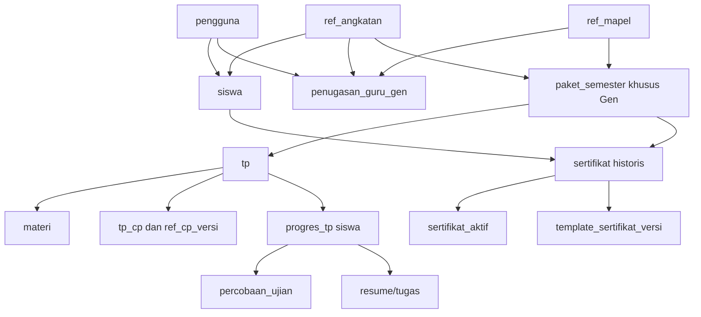

# 10 — Model Database dan Kontrak Dump SQL

## 1. Aturan deployment database — WAJIB
**Tidak memakai CI4 migrations dan seeders dalam alur pembangunan, instalasi, atau pembaruan.** Database lokal **MySQL** dan hosting **MariaDB**. Database dibuat dan diubah melalui **impor berkas `.sql`** versi yang disediakan proyek: `database/sql/install/` untuk instalasi dari nol, `database/sql/updates/` untuk pembaruan data/skema **incremental**. Setiap file SQL harus bisa diimpor dari phpMyAdmin pada shared hosting, selain lewat CLI. Jangan menggunakan perintah `php spark migrate` / `db:seed` pada petunjuk pemasangan.

**Istilah:** `dump instalasi` adalah snapshot **struktur+data referensi bawaan tanpa data siswa produksi**. `update SQL` adalah patch bernomor yang mengubah skema atau data yang diperlukan **tanpa menjatuhkan/menghapus tabel atau nilai produksi**. Jangan menyamakan update dengan impor ulang dump penuh secara destruktif.

## 2. Kelompok tabel logis
Nama di bawah adalah **kontrak desain**. Saat menulis dump SQL, cocokan dengan `skema-v2.sql` aktual, gunakan nama tunggal yang dipilih di source final, dan sertakan FK/indeks. Tidak semua tabel baru harus dibuat jika entitas setara sudah ada.

| Kelompok | Entitas/tabel minimum | Kontrak data |
|---|---|---|
| Akun | `pengguna`, `pengguna_peran`, `siswa`, `profil_pengelola`, `ci_sessions` | akun bersama; siswa NISN dan Gen, staf profil kontak/foto, sandi hash, status & audit |
| Referensi | `ref_angkatan`, `ref_semester`, `ref_mapel`, `penugasan_guru_gen`, `riwayat_penugasan_guru_gen`, `ref_jenjang`, `ref_fase`, `ref_kelas`, `ref_kurikulum`, `ref_tahun_ajaran` | Guru aktif unik per Gen–Mapel; mapel tidak lagi mempunyai Guru global; semester 1–6 |
| CP | `ref_cp`, `ref_cp_versi`, `usulan_cp`, `tp_cp` | CP versi immutable, usulan diputus Admin, tepat satu CP utama per TP |
| Konten | `paket_semester`, `penugasan_paket`, `tp`, `tp_cp`, `versi_konten_tp`, `materi`, `berkas` | `paket_semester.angkatan_id` wajib; objek TP/soal/materi khusus satu Gen, historis terjaga |
| Impor | `impor_atp`, `impor_atp_baris`, `impor_soal_docx`, `impor_soal_baris`, `impor_akun`, `impor_akun_baris` | Impor ATP Excel, bank soal DOCX dan impor akun adalah alur terpisah; checksum/versi/UUID/idempoten serta jejak Admin |
| Asesmen | `soal`, `pilihan`, `percobaan_ujian`, `jawaban_percobaan`, `riwayat_status_ujian`, `segmen_jeda_ujian`, `pelanggaran_ujian`, `tambahan_percobaan` | snapshot soal/kunci/opsi server, server timer, attempt sah/batal terpisah |
| Belajar | `progres_tp`, `progres_materi`, `resume_materi`, `tugas_hots_materi` | progres/versi TP terpin, draf DB manual, nilai dan siapa menilai |
| Koreksi | `koreksi_tp`, `usulan_koreksi_nilai`, `riwayat_nilai`, `koreksi_ujian`, `riwayat_identitas` | pengusul, pemutus, versi asal, alasan, nilai sebelum/sesudah |
| Hasil | `sertifikat`, `sertifikat_aktif`, `pekerjaan_revisi_sertifikat`, `log_sertifikat`, `lencana_siswa` | nomor/QR unik, satu berlaku per pasangan, histori immutable |
| Branding | `pengaturan`, `aset_identitas`, `template_sertifikat`, `template_sertifikat_versi` | data madrasah, logo aplikasi sebagai favicon, TTD PNG privat dan template historis, template historis |
| LMS | `notifikasi`, `pengumuman`, `faq`, `log_aktivitas` | notifikasi internal, pengumuman global, FAQ login-only, audit |

### Relasi inti


## 3. Invarian SQL dan transaksi
1. `pengguna.username` unik; `siswa.nisn` unik; username diubah bersama NISN di **satu transaksi** dengan log.
2. `penugasan_guru_gen` mempunyai **UNIQUE(angkatan_id,mapel_id)** dan `guru_id` nullable, FK ke Guru aktif yang juga tervalidasi peran melalui Service. Admin dapat menugaskan seorang Guru ke beberapa Gen/mapel. `ref_mapel.guru_id` (kolom warisan K2) bukan penentu hak v2.4; migrasi non-destruktif mempertahankan data sampai transisi teruji.
3. `paket_semester.angkatan_id` wajib dan paket tidak dapat ditugaskan ke Gen yang berbeda dari pemiliknya; `penugasan_paket` unik **untuk penugasan yang aktif** per (angkatan,mapel,semester,tahun ajaran); implementasi MariaDB/MySQL bisa memakai pointer/constraint service atau kolom materialisasi untuk indeks unik, jangan mengandalkan partial index yang tak tersedia.
4. `UNIQUE(paket_semester_id,kode_tp)`; `UNIQUE(tp_id,cp_versi_id)`; tepat satu CP utama per TP divalidasi Service dan diuji.
5. `UNIQUE(siswa_id,tp_id,versi_paket_yang_ditugaskan)` untuk progres TP dalam satu konteks; `UNIQUE(percobaan_id,soal_snapshot_id)` untuk jawaban. Tidak ada dua percobaan **berjalan atau jeda** bersamaan untuk siswa+TP+jenis.
6. `sertifikat.nomor` unik dan `kode_verifikasi` unik; **tidak** memakai UNIQUE sederhana `(siswa_id,paket_semester_id)` di tabel versi historis; `sertifikat_aktif` memiliki satu pointer unik `(siswa_id,paket_semester_id)` yang diarahkan ke versi `berlaku`.
7. `usulan_koreksi_nilai` memiliki versi asal dan status; setelah diterapkan, tidak dapat diterapkan ulang. `riwayat_nilai` append-only secara fungsional.
8. Berkas yang dipakai sertifikat/TP historis tidak di-overwrite dan tidak dihapus otomatis.
9. Waktu simpan UTC atau timezone konsisten yang kemudian ditampilkan Asia/Jakarta; pilih satu standar secara eksplisit pada implementasi dan pakai di semua service/database.
10. Pengecekan referensial dilakukan ulang sebelum commit, bukan hanya lewat JavaScript.

### Struktur data lama yang tetap relevan pada v2.4
- `ref_mapel` menyimpan identitas kode/nama mapel saja untuk kewenangan baru. Sumber G1 adalah `penugasan_guru_gen(id,angkatan_id,mapel_id,guru_id,diubah_oleh,diubah_pada)`, pasangan Gen–Mapel unik. FK pengguna membatasi ID valid; Service menegakkan status aktif + peran Guru. Baris boleh ada tanpa Guru; dropdown Guru hanya akun aktif dengan role `guru`. `riwayat_penugasan_guru_gen` menyimpan Guru sebelum/sesudah, alasan, Admin dan waktu, append-only.
- `siswa(id,pengguna_id,nisn,angkatan_id,semester_mulai,...)`: `pengguna_id` unik dan FK, `nisn` unik 10 angka, `angkatan_id` wajib sebelum siswa dapat belajar. Koreksi NISN = update `pengguna.username` dan `siswa.nisn` satu transaksi+audit; tidak mengganti `siswa_id`.
- `profil_pengelola(pengguna_id,foto_aset_id,telepon_pribadi,...)`: staf mengubah hanya atribut profil sendiri yang diizinkan; nama resmi/NIP/peran/penugasan ditangani Admin. Foto berada di storage privat dengan pemeriksaan upload. Data publik Guru dibuat melalui proyeksi terbatas tanpa telepon pribadi/NIP.
- `paket_semester.angkatan_id` merupakan FK wajib. `penugasan_paket` hanya menunjuk paket dari Gen yang sama; Service memeriksa Gen/Mapel/semester/tahun ajaran saat menetapkan, memulai progres, menilai, dan merevisi. TP/soal/materi mengikuti Gen paket induk, tanpa objek pembelajaran bersama lintas Gen. CP resmi tetap bisa dipakai lintas Gen.
- `impor_akun` dan `impor_akun_baris` menyimpan metadata file versi template/checksum, jenis Pengelola/Siswa, Admin, status, ringkasan galat dan kunci idempoten; **tidak menyimpan sandi plaintext**. Simpan perubahan akun dan peran secara transaksional; file tanpa baris tertentu bukan perintah penghapusan.
- Reset sandi menaikkan `pengguna.versi_sesi`, mengaktifkan `wajib_ganti_sandi`, mencatat peristiwa tanpa menyimpan sandi sementara. Export XLSX dibuat server dari daftar yang difilter, menetralkan sel formula, tidak menyertakan sandi/hash/token/sesi.
- Penguncian transaksi berlaku pada pergantian G1, perubahan profil resmi, impor akun, NISN, pengikatan paket dan penilaian. Selalu cek FK, status dan otorisasi kembali sebelum commit.

## 4. Parameter `pengaturan` penting
| Kunci | Bawaan/kebijakan |
|---|---|
| `nama_madrasah`, `alamat_madrasah`, `npsn`, `nsm`, `telepon`, `email` | Diisi Admin; wajib sesuai pilihan K20 B; situs web opsional |
| `kota_penerbitan`, `kepala_madrasah_nama`, `kepala_madrasah_nip` | Diisi Admin |
| `logo_aplikasi_aset_id`, `ttd_png_versi_id` | Referensi berkas, jangan simpan binary dalam kunci nilai |
| `template_sertifikat_aktif_id` | Pointer global; fallback bawaan jika kosong |
| `kkm_bawaan`, `bobot_resume_bawaan`, `bobot_tugas_bawaan`, `bobot_sumatif_bawaan` | 75; 20/30/50 |
| `resume_min_karakter`, `tugas_min_karakter` | 50; 200 |
| `diag_jumlah_soal`, `diag_durasi_menit` | 10; 30 |
| `sum_jumlah_soal`, `sum_durasi_menit`, `sum_maks_percobaan` | 20; 60; 3 |
| `waktu_pdf_per_halaman_detik`, `persen_putar_minimal`, `waktu_gambar_detik` | 15; 90; 30 |
| `ujian_maks_jeda_fullscreen_kejadian_detik` | 90 |
| `ujian_maks_total_jeda_fullscreen_detik` | 180 |
| `ujian_timeout_heartbeat_detik` | 20 |
| `ujian_maks_total_jeda_koneksi_detik` | 300 |
| `profil_keamanan_ujian` | `ketat` tetap, tanpa selector profil lain |
| `sesi_menit`, `sandi_min_karakter`, `login_maks_gagal`, `login_kunci_menit` | 120; 8; 5; 5 |
| `kemiripan_ambang` | 60; hanya penanda review Guru, tidak blokir siswa |
| `pdf_maks_mb`, `pdf_maks_halaman`, `audio_maks_mb`, `gambar_sisi_maks_px` | 15; 40; 10; 1600 (hanya berkas materi) |

## 5. Paket SQL instalasi dan update
**Struktur file yang wajib dibuat programmer ketika membangun DB final (nama/urutan SQL nyata ditentukan setelah dump lokal dianalisis):**
```text
database/sql/
├── README.md
├── install/
│   └── sla_sks_v2_4_full.sql           # DDL + data bawaan non-pribadi
└── updates/
    └── NNNN_*.sql                     # pembaruan bernomor sesuai versi skema nyata setelah dump dianalisis
```

- Semua SQL UTF-8/`utf8mb4`; gunakan sintaks kompatibel **MySQL lokal dan MariaDB hosting**. Uji impor bersih di keduanya.
- File update bernomor berurutan dan **tidak pernah** membuat `DROP DATABASE`/`TRUNCATE` tabel produksi. Sediakan `schema_version`/`riwayat_update_sql` dan catatan urutan/pra-syarat. Gunakan DDL kompatibel target, backup manual lebih dahulu, dan *maintenance mode* saat patch berisiko.
- Karena banyak DDL MySQL/MariaDB melakukan implicit commit, **jangan mengklaim seluruh pembaruan otomatis bisa di-rollback lewat transaksi**. Sediakan backup/restorasi dan prosedur kegagalan yang nyata.
- Admin awal tidak dibuat oleh CI4 Seeder: instalasi membuat akun lewat **skrip inisialisasi sekali pakai yang aman** atau data import terenkripsi/hash yang diberikan ketika instalasi. **Jangan hardcode password plaintext/default yang diketahui publik dalam dump yang dipush ke repo.** Setelah login pertama, wajib ganti sandi.
- Jangan pernah menyimpan dump data siswa nyata pada repo. Ekspor data produksi dan backup hanya berada di lokasi privat.

### Transisi basis data ke kontrak v2.4
**Pola yang diminta pemilik khusus localhost:** ketika implementasi dimulai, pemilik akan mengirim dump SQL lokal terkini. Developer wajib **menganalisis skema, versi dan isi dump**, memilih data lama yang perlu dipertahankan, membuat **dump instalasi final baru yang telah mencakup data terpilih**, dan memberikan petunjuk import. **Pemilik secara eksplisit akan mengosongkan seluruh tabel DB lokal yang dipilih setelah backup**, kemudian mengimpor dump baru di XAMPP. Jangan menjatuhkan tabel dari aplikasi atau menjalankan operasi tersebut sebelum dump ditinjau dan persetujuan tetap jelas. **Reset ini hanya untuk database lokal pengembangan, tidak berlaku untuk hosting/produksi**; produksi memakai patch additive bernomor yang aman.

- Jika masih ada tabel `bab`, `versi_konten_bab`, `tugas_tp` pada dump **historis** (bukan kontrak skema final), analisis relasi/isinya terlebih dulu; transformasi data terpilih ke **`tp` sebagai unit langsung di bawah `paket_semester`**, `versi_konten_tp`, dan **`tugas_hots_materi`**. Konflik banyak TP per BAB tidak boleh otomatis dipaksa jadi satu atau dihapus: petakan TP dan materi berdasarkan identitas/urutan, catat ambiguitas untuk diperiksa.
- Tidak mengasumsikan dump lama bersih atau tabel `0009` sudah lengkap. Periksa `schema_version`, FK, jumlah/unik identitas, kemiripan data, hash pengguna, referensi Gen/CP, histori ujian dan file privat. Tidak memasukkan data siswa nyata/credential/backup privat ke GitHub.
- Perbaikan kontrak SQL, generator XLSX/Word, Service dan UI dilakukan di **branch implementasi terpisah** dari PR dokumentasi ini dan diuji MySQL/MariaDB. Dump final bukan sekadar skema kosong bila pengguna meminta data lama penting ikut dipertahankan.

## 5A. Kontrak tambahan model v2.4
1. **Relasi inti:** `paket_semester.id → tp.paket_semester_id → materi.tp_id → tugas_hots_materi.materi_id`. **Tidak ada entitas BAB operasional**. Tepat satu kunci unik per TP pada paket, dan urutan ATP berdasarkan semester/urut TP. `tp_cp` mengikat CP versi aktif dan tepat satu CP utama per TP.
2. Setiap Materi mempunyai satu instruksi Resume dan satu tugas HOTS; `resume_materi` serta pengiriman/penilaian HOTS mengacu pada Materi, siswa, versi konten terpin, penilai dan histori, bukan hanya TP. Bank `soal` Diagnostik/Sumatif mengacu pada `tp_id` dan versi TP; satu soal PG **lima opsi A–E** dengan satu kunci.
3. Konten campuran Word tidak boleh diflatten menjadi teks; simpan representasi aman yang mencatat paragraf/Equation/gambar/tabel bersarang, pilihan terkait dan aset privat. Metadata impor menautkan Guru/Gen/Mapel/TP/jenis/versi/checksum/idempoten; tidak bocor kunci ke siswa.
4. Excel ATP enam semester diunduh per **Gen–Mapel + Kurikulum**. Generator menanam identitas/snapshot versi/kode CP aktif yang dapat diverifikasi saat impor, tanpa berisi data Gen lain. `impor_atp` dan `impor_soal_docx` punya pratinjau dan konfirmasi transaksional terpisah. Hapus by omission dilarang.
5. **Logo aplikasi** menggunakan aset unggahan tervalidasi yang juga menjadi favicon (bisa menghasilkan varian favicon dari satu sumber); aset ber-versi serta cache/riwayat dikelola. Berkas TTD/sertifikat tetap dilindungi sesuai dokumen 09.


## 6. Pemeriksaan lintas DB dan target
Karena MySQL lokal dan MariaDB hosting **berbeda mesin**, semua enum, CHECK constraint, generated column, index, JSON, collation dan DDL alter harus diuji pada **versi spesifik keduanya**, bukan dianggap identik. Catat versi yang lulus tes pada `15-INSTALASI-DAN-OPERASIONAL.md`. Ukuran data kecil tidak menghapus kebutuhan FK, transaksi, indeks, atau audit.

## 7. Larangan penghapusan
Tidak ada tombol/batch yang menghapus fisik siswa, sertifikat, riwayat nilai, snapshot ujian, file historis, atau log akademik. Data akun nonaktif tetap ada. Berkas temporer upload yang belum sah boleh dibersihkan dengan pembeda jelas dari dokumen historis.
