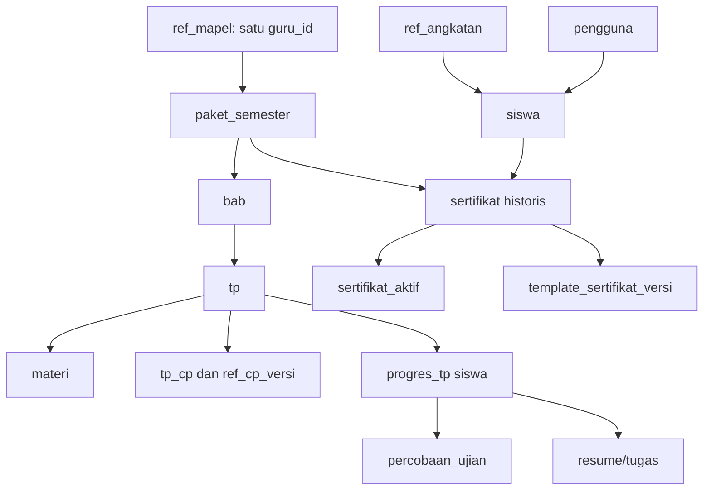

# 10 — Model Database dan Kontrak Dump SQL

## 1. Aturan deployment database — WAJIB
**Tidak memakai CI4 migrations dan seeders dalam alur pembangunan, instalasi, atau pembaruan.** Database lokal **MySQL** dan hosting **MariaDB**. Database dibuat dan diubah melalui **impor berkas `.sql`** versi yang disediakan proyek: `database/sql/install/` untuk instalasi dari nol, `database/sql/updates/` untuk pembaruan data/skema **incremental**. Setiap file SQL harus bisa diimpor dari phpMyAdmin pada shared hosting, selain lewat CLI. Jangan menggunakan perintah `php spark migrate` / `db:seed` pada petunjuk pemasangan.

**Istilah:** `dump instalasi` adalah snapshot **struktur+data referensi bawaan tanpa data siswa produksi**. `update SQL` adalah patch bernomor yang mengubah skema atau data yang diperlukan **tanpa menjatuhkan/menghapus tabel atau nilai produksi**. Jangan menyamakan update dengan impor ulang dump penuh secara destruktif.

## 2. Kelompok tabel logis
Nama di bawah adalah **kontrak desain**. Saat menulis dump SQL, cocokan dengan `skema-v2.sql` aktual, gunakan nama tunggal yang dipilih di source final, dan sertakan FK/indeks. Tidak semua tabel baru harus dibuat jika entitas setara sudah ada.

| Kelompok | Entitas/tabel minimum | Kontrak data |
|---|---|---|
| Akun | `pengguna`, `pengguna_peran`, `siswa`, `ci_sessions` | username unik, hash sandi, peran aktif via sesi, siswa→Gen, soft nonaktif |
| Referensi | `ref_angkatan`, `ref_semester`, `ref_mapel`, `ref_jenjang`, `ref_fase`, `ref_kelas`, `ref_kurikulum`, `ref_tahun_ajaran` | Mapel memiliki satu `guru_id`; semester 1–6 |
| CP | `ref_cp`, `ref_cp_versi`, `usulan_cp`, `tp_cp` | CP versi immutable, usulan diputus Admin, tepat satu CP utama per TP |
| Konten | `paket_semester`, `penugasan_paket`, `bab`, `versi_konten_bab`, `tp`, `materi`, `berkas` | Versi historis konten, BAB draf/siap, TP/CP, paket terikat Gen/tahun |
| Impor | `impor_bab`, `impor_baris` | checksum, HMAC, UUID stabil, versi struktur, idempoten |
| Asesmen | `soal`, `pilihan`, `percobaan_ujian`, `jawaban_percobaan`, `riwayat_status_ujian`, `segmen_jeda_ujian`, `pelanggaran_ujian`, `tambahan_percobaan` | snapshot soal/kunci/opsi server, server timer, attempt sah/batal terpisah |
| Belajar | `progres_tp`, `progres_materi`, `resume_materi`, `tugas_tp` | progres/versi TP terpin, draf DB manual, nilai dan siapa menilai |
| Koreksi | `koreksi_bab`, `usulan_koreksi_nilai`, `riwayat_nilai`, `koreksi_ujian`, `riwayat_identitas` | pengusul, pemutus, versi asal, alasan, nilai sebelum/sesudah |
| Hasil | `sertifikat`, `sertifikat_aktif`, `pekerjaan_revisi_sertifikat`, `log_sertifikat`, `lencana_siswa` | nomor/QR unik, satu berlaku per pasangan, histori immutable |
| Branding | `pengaturan`, `aset_identitas`, `template_sertifikat`, `template_sertifikat_versi` | data madrasah, ikon/logo/TTD PNG terpisah, template historis |
| LMS | `notifikasi`, `pengumuman`, `faq`, `log_aktivitas` | notifikasi internal, pengumuman global, FAQ login-only, audit |

### Relasi inti


## 3. Invarian SQL dan transaksi
1. `pengguna.username` unik; `siswa.nisn` unik; username diubah bersama NISN di **satu transaksi** dengan log.
2. `ref_mapel.guru_id` hanya satu, nullable saat kosong; satu Guru boleh tercatat di banyak mapel.
3. `penugasan_paket` unik **untuk penugasan yang aktif** per (angkatan,mapel,semester,tahun ajaran); implementasi MariaDB/MySQL bisa memakai pointer/constraint service atau kolom materialisasi untuk indeks unik, jangan mengandalkan partial index yang tak tersedia.
4. `UNIQUE(bab_id,kode_tp)`; `UNIQUE(tp_id,cp_versi_id)`; tepat satu CP utama per TP divalidasi Service dan diuji.
5. `UNIQUE(siswa_id,tp_id,versi_paket_yang_ditugaskan)` untuk progres TP dalam satu konteks; `UNIQUE(percobaan_id,soal_snapshot_id)` untuk jawaban. Tidak ada dua percobaan **berjalan atau jeda** bersamaan untuk siswa+TP+jenis.
6. `sertifikat.nomor` unik dan `kode_verifikasi` unik; **tidak** memakai UNIQUE sederhana `(siswa_id,paket_semester_id)` di tabel versi historis; `sertifikat_aktif` memiliki satu pointer unik `(siswa_id,paket_semester_id)` yang diarahkan ke versi `berlaku`.
7. `usulan_koreksi_nilai` memiliki versi asal dan status; setelah diterapkan, tidak dapat diterapkan ulang. `riwayat_nilai` append-only secara fungsional.
8. Berkas yang dipakai sertifikat/BAB historis tidak di-overwrite dan tidak dihapus otomatis.
9. Waktu simpan UTC atau timezone konsisten yang kemudian ditampilkan Asia/Jakarta; pilih satu standar secara eksplisit pada implementasi dan pakai di semua service/database.
10. Pengecekan referensial dilakukan ulang sebelum commit, bukan hanya lewat JavaScript.

## 4. Parameter `pengaturan` penting
| Kunci | Bawaan/kebijakan |
|---|---|
| `nama_madrasah`, `alamat_madrasah`, `npsn`, `nsm`, `telepon`, `email` | Diisi Admin; wajib sesuai pilihan K20 B; situs web opsional |
| `kota_penerbitan`, `kepala_madrasah_nama`, `kepala_madrasah_nip` | Diisi Admin |
| `logo_madrasah_aset_id`, `ikon_aplikasi_aset_id`, `ttd_png_versi_id` | Referensi berkas, jangan simpan binary dalam kunci nilai |
| `template_sertifikat_aktif_id` | Pointer global; fallback bawaan jika kosong |
| `kkm_bawaan`, `bobot_resume_bawaan`, `bobot_tugas_bawaan`, `bobot_sumatif_bawaan` | 75; 20/30/50 |
| `resume_min_karakter`, `tugas_min_karakter` | 50; 200 |
| `diag_jumlah_soal`, `diag_durasi_menit` | 10; 30 |
| `sum_jumlah_soal`, `sum_durasi_menit`, `sum_maks_percobaan` | 20; 60; 3 |
| `waktu_pdf_per_halaman_detik`, `persen_putar_minimal`, `waktu_gambar_detik` | 15; 90; 30 |
| `ujian_maks_jeda_fullscreen_kejadian_detik` | 90 |
| `ujian_maks_total_jeda_fullscreen_detik` | 180 |
| `ujian_timeout_heartbeat_detik` | 20 |
| `ujian_maks_total_jeda_koneksi_detik` | 300 |
| `profil_keamanan_ujian` | `ketat` tetap, tanpa selector profil lain |
| `sesi_menit`, `sandi_min_karakter`, `login_maks_gagal`, `login_kunci_menit` | 120; 8; 5; 5 |
| `kemiripan_ambang` | 60; hanya penanda review Guru, tidak blokir siswa |
| `pdf_maks_mb`, `pdf_maks_halaman`, `audio_maks_mb`, `gambar_sisi_maks_px` | 15; 40; 10; 1600 (hanya berkas materi) |

## 5. Paket SQL instalasi dan update
**Struktur file yang wajib dibuat programmer ketika membangun DB:**
```text
database/sql/
├── README.md
├── install/
│   └── sla_sks_v2_2_full.sql           # DDL + data bawaan non-pribadi
└── updates/
    ├── 0001_*.sql                     # patch skema/data awal berikutnya
    └── 0002_*.sql
```

- Semua SQL UTF-8/`utf8mb4`; gunakan sintaks kompatibel **MySQL lokal dan MariaDB hosting**. Uji impor bersih di keduanya.
- File update bernomor berurutan dan **tidak pernah** membuat `DROP DATABASE`/`TRUNCATE` tabel produksi. Sediakan `schema_version`/`riwayat_update_sql` dan catatan urutan/pra-syarat. Gunakan DDL kompatibel target, backup manual lebih dahulu, dan *maintenance mode* saat patch berisiko.
- Karena banyak DDL MySQL/MariaDB melakukan implicit commit, **jangan mengklaim seluruh pembaruan otomatis bisa di-rollback lewat transaksi**. Sediakan backup/restorasi dan prosedur kegagalan yang nyata.
- Admin awal tidak dibuat oleh CI4 Seeder: instalasi membuat akun lewat **skrip inisialisasi sekali pakai yang aman** atau data import terenkripsi/hash yang diberikan ketika instalasi. **Jangan hardcode password plaintext/default yang diketahui publik dalam dump yang dipush ke repo.** Setelah login pertama, wajib ganti sandi.
- Jangan pernah menyimpan dump data siswa nyata pada repo. Ekspor data produksi dan backup hanya berada di lokasi privat.

## 6. Pemeriksaan lintas DB dan target
Karena MySQL lokal dan MariaDB hosting **berbeda mesin**, semua enum, CHECK constraint, generated column, index, JSON, collation dan DDL alter harus diuji pada **versi spesifik keduanya**, bukan dianggap identik. Catat versi yang lulus tes pada `15-INSTALASI-DAN-OPERASIONAL.md`. Ukuran data kecil tidak menghapus kebutuhan FK, transaksi, indeks, atau audit.

## 7. Larangan penghapusan
Tidak ada tombol/batch yang menghapus fisik siswa, sertifikat, riwayat nilai, snapshot ujian, file historis, atau log akademik. Data akun nonaktif tetap ada. Berkas temporer upload yang belum sah boleh dibersihkan dengan pembeda jelas dari dokumen historis.
